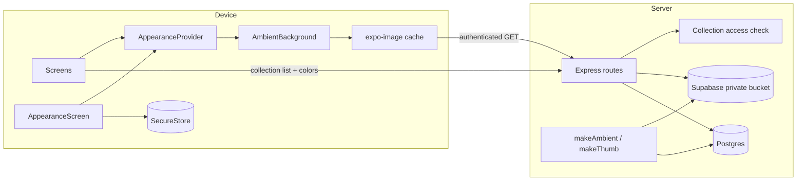
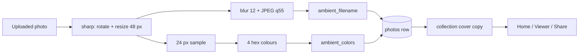

# Warm Glass — build spec

Status: proposed, ready to implement  
Scope: Expo Android app + Express/Supabase server  
Design source: boards 06 (hybrid), 07 (pushed gallery/share), 08 (adaptive backdrop)

---

## 1. Decision summary

The app moves from the current flat "Edition" look to **Warm Glass**:

- **01 Quiet Luxury** supplies the structure: paper canvas, Newsreader serif, ink + bronze palette, generous spacing.
- **02 Liquid Glass** supplies the material: translucent layers, floating captions, sheets and dock, but warm and light rather than cool and dark.
- **07 Max** is used where the photo should dominate: gallery detail, photo viewer and share/QR.
- **08 Adaptive Backdrop** is a first-class feature: the shell samples the collection's photos and tints itself, with a master switch in Settings.

Locked defaults:

| Decision | Value |
| --- | --- |
| Base direction | Warm Glass, split: calm Home + Max gallery/viewer/share |
| Fonts | Reuse **Newsreader** + **Instrument Sans** (no new font families) |
| Adaptive default | On, `subtle` on Home, `balanced` in viewer |
| Blur approach | Server-generated 48 px ambient image, **no native blur dependency** |
| Settings storage | Local device (SecureStore), v1 only |
| QR tile | Always solid white, never translucent |

> The concept boards use Fraunces/Inter for speed. Implementation maps them to the fonts already bundled in `app/`: Newsreader for display/serif and Instrument Sans for labels/UI. The silhouette and spacing stay the same.

---

## 2. Goals and non-goals

### Goals

1. Ship the Warm Glass visual system on the five screens users touch most.
2. Make the background react to the photos, cheaply and privately.
3. Make the adaptive feature obvious, controllable and fully reversible.
4. Keep the existing data model and flows: collections, QR sharing, paid originals, expiry.
5. Stay on the current Expo 51 stack; do not block on a native blur upgrade.

### Non-goals (v1)

- Auth, signup, onboarding and scan screens (they keep the current Edition chrome).
- Web/PWA theming.
- Server-synced appearance preferences.
- Animated video backgrounds, parallax or live camera wallpaper.
- AI-generated palettes. This is deterministic image statistics.

---

## 3. Screen plan

### 3.1 Home / Collections — calm glass

File: `app/src/screens/HomeScreen.tsx`, `app/src/MainTabs.tsx`

- Full-screen adaptive backdrop: up to **4 ambient images** from the first page of collections in a 2×2 grid, under a paper wash.
- Header: glass pill with wordmark + avatar.
- Display: `Your collections` in Newsreader, ink, 44–46 px.
- Search: frosted pill.
- Adaptive status chip: `Adaptive · 4 covers` with four palette dots.
- Featured card: photo thumb + serif title + price pill + `Open →`.
- List rows: 42 px thumbs, serif titles, muted metadata.
- Bottom dock: floating glass pill (Collections / Scan / Account), active item on solid cream.
- Pull-to-refresh and pagination stay.
- Off state: current paper background, same layout; no ambient requests.

### 3.2 Gallery detail — photo-first

File: `app/src/screens/GalleryScreen.tsx`

- 460–480 px full-bleed cover.
- Dark smoked-glass caption floating over the photo: collection name, count, price.
- Light glass sheet starting on the photo and fading into paper:
  - Share QR / Sell actions.
  - 3-column grid with `+N more`.
  - Sticky `Unlock originals — $N` CTA.
- This is board 07's gallery, adapted to the existing data.

### 3.3 Photo viewer — adaptive

File: `app/src/components.tsx` (`PhotoViewer`)

- Background: the **current photo's ambient**, heavily blurred and dimmed.
- Sharp photo card centered, 20 px radius.
- Dark glass top bar (back, `04 / 18`, close).
- Dark glass info card (title, count, price).
- Glass action row: Share / Sell / Save.
- Pagination dots.
- On swipe settle, swap the ambient with a 350 ms crossfade.

### 3.4 Share / QR — glass card, solid QR

File: `app/src/screens/QRDisplayScreen.tsx`

- Background: collection ambient + warm scrim.
- Serif `Share this collection`.
- Dark glass card holding the QR.
- **QR tile is solid white with black modules** — no transparency, no blur, no colour tint.
- Price + `Originals unlock after payment`.
- Cream `Copy link` CTA + glass secondary.
- The QR must remain scannable from another phone at arm's length.

### 3.5 Settings / Appearance

Files: new `app/src/screens/AppearanceScreen.tsx`, `app/src/App.tsx`, `app/src/screens/AccountScreen.tsx`

- Entry row in Account: `Appearance` with current mode summary.
- Screen sections:
  - **Adaptive background** master switch.
  - **Source**: Collections / Photo / Both.
  - **Intensity**: Subtle / Balanced / Vivid.
  - **Reduce motion** switch (disables crossfade).
  - **Preview** card using the latest collection's palette.
  - Privacy note: "Generated on your server from a 48 px copy."
- When the switch is off, the options collapse and every screen uses the paper theme.

---

## 4. Design tokens

Create `app/src/theme/warmGlass.ts` (new) and keep the old `styles.ts` for auth/onboarding until those screens are migrated.

```ts
export const wg = {
  color: {
    paper: '#F4EFE5',
    paperDeep: '#EDE5D7',
    ivory: '#FAF5EA',
    ink: '#211C15',
    inkSoft: '#3B3428',
    muted: '#847A69',
    line: '#DCD3C2',
    bronze: '#96764D',
    tealFallback: '#2F7F79',
    glassLight: 'rgba(255,252,245,0.58)',
    glassDark: 'rgba(20,17,13,0.41)',
    highlight: 'rgba(255,255,255,0.72)',
  },
  radius: { card: 24, sheet: 30, photo: 16, chip: 999 },
  space: { xs: 4, sm: 8, md: 12, lg: 16, xl: 24, xxl: 32 },
  font: {
    serif: 'Newsreader_400Regular',
    serifMedium: 'Newsreader_500Medium',
    serifItalic: 'Newsreader_400Regular_Italic',
    sans: 'InstrumentSans_400Regular',
    sansMedium: 'InstrumentSans_500Medium',
    sansSemi: 'InstrumentSans_600SemiBold',
  },
  wash: { subtle: 0.72, balanced: 0.58, vivid: 0.42 },
} as const
```

Glass implementation on Expo 51:

- Use translucent backgrounds + 1 px light border + warm shadow.
- Do **not** depend on `expo-blur` for Android. If a native blur is available on iOS, it can be added later behind the same component.
- `expo-linear-gradient` is added for the scrim gradients (one small Expo package).
- All text on glass is either ink on the light wash or ivory on the dark scrim. No white-on-unknown-photo.

---

## 5. Architecture



### Ambient pipeline



---

## 6. Data model

New migration: `supabase/migrations/20261102_ambient.sql`

```sql
alter table photos
  add column if not exists ambient_filename text,
  add column if not exists ambient_colors jsonb;

alter table collections
  add column if not exists ambient_filename text,
  add column if not exists ambient_colors jsonb;
```

Why both levels:

- **photos** carries the per-photo ambient for the viewer.
- **collections** carries the cover ambient for Home and Share, so the list endpoint does not need a join per item.

Keep the collection copy in sync in the cover-setting path: when `cover_filename` changes, copy the chosen photo's `ambient_filename` and `ambient_colors` onto the collection. When a photo is uploaded into a collection with no cover, the same copy happens. A missing ambient is allowed and falls back to paper.

The existing `makeThumb()` in `server/src/routes.ts` is the template. Add:

```ts
async function makeAmbient(buffer: Buffer): Promise<{
  ambient: Buffer
  colors: string[]
} | null> {
  try {
    const base = sharp(buffer).rotate()
    const ambient = await base
      .clone()
      .resize(48, 48, { fit: 'inside' })
      .blur(12)
      .jpeg({ quality: 55, mozjpeg: true })
      .toBuffer()

    const raw = await base
      .clone()
      .resize(24, 24, { fit: 'inside' })
      .removeAlpha()
      .raw()
      .toBuffer()

    // Sample 4 quadrants, average each, return hex. Dedupe and pad with the average.
    return { ambient, colors: sampleQuadrants(raw) }
  } catch {
    return null
  }
}
```

Generation is non-blocking: a failed ambient must never fail a photo upload.

Backfill:

- Add `server/scripts/backfill-ambient.ts` for existing photos.
- Lazy fallback: if a collection has a cover but no ambient, generate from `cover_thumb_filename` on first request and cache.

---

## 7. API

### New routes

| Method | Route | Returns |
| --- | --- | --- |
| GET | `/api/collections/:id/ambient` | 48 px JPEG, collection access check |
| GET | `/api/photos/:id/ambient` | 48 px JPEG, collection access check |

Rules:

- Same auth and membership check as the existing photo file route.
- `Cache-Control: private, max-age=86400, immutable`.
- `ETag` based on `ambient_filename`.
- 404 when no ambient exists; the client falls back to paper.
- Never expose a public bucket URL.

### Collection payload

Add to `GET /api/collections`:

```json
{
  "ambient_colors": ["#2F7F79", "#C9B98F", "#B77A44", "#4E6B3F"],
  "has_ambient": true
}
```

Add the same fields to the collection detail and photo payloads as needed.

---

## 8. Client state and components

### 8.1 AppearanceProvider

New file: `app/src/appearance.tsx`

```ts
export type Intensity = 'subtle' | 'balanced' | 'vivid'
export type AmbientSource = 'collections' | 'photo' | 'both'

export type Appearance = {
  adaptive: boolean
  intensity: Intensity
  source: AmbientSource
  reduceMotion: boolean
}
```

- Defaults: `{ adaptive: true, intensity: 'subtle', source: 'both', reduceMotion: false }`.
- Persist JSON under `photoshare.appearance` using the existing `getValue` / `setValue` from `app/src/storage.ts`.
- Load once at app start; render paper until loaded to avoid a flash.
- Provide `useAppearance()` and `setAppearance()`.
- If `adaptive` is false, `AmbientBackground` returns `null` and no image requests are made.

### 8.2 AmbientBackground

New file: `app/src/components/AmbientBackground.tsx`

```tsx
type Props = {
  kind: 'collection' | 'photo'
  id?: string
  variant: 'light' | 'dark'
  children?: React.ReactNode
}
```

Behavior:

- Builds the URL and sends `imageHeaders()`.
- `expo-image` with `contentFit="cover"`, `transition={reduceMotion ? 0 : 350}`, `cachePolicy="memory-disk"`.
- Renders a wash layer (`expo-linear-gradient`) with opacity from the intensity.
- Light variant: paper wash 0.42 → 0.72 → 0.88, ink text.
- Dark variant: dark scrim 0.34 → 0.56, ivory text.
- Memoize; only re-render when `id` or appearance changes.
- If the image 404s, render the paper base and keep the layout stable.

### 8.3 Home ambient mosaic

- Take up to 4 collections from the first page with `has_ambient`.
- Render their ambient URLs in a 2×2 `View`; each cell is 48 px upscaled and covered by the wash.
- If fewer than 4, repeat the last one or use the paper gradient.
- Do not fetch more than 4 ambient assets on Home.
- When the cover changes, the list refresh changes the ambient URLs.

### 8.4 Viewer ambient

- `PhotoViewer` tracks the settled index.
- Render one `AmbientBackground` at the modal root.
- On index change, update the `id`; expo-image crossfades.
- Keep the sharp photo in the foreground; never blur the displayed photo itself.

---

## 9. Settings UX

`AccountScreen` gets a row:

```
Appearance
Warm Glass · Adaptive, subtle
```

Opens `AppearanceScreen`:

```
APPEARANCE

Adaptive background                  [on]
Tint the shell with the colours of your photos.

Source
[ Collections ] [ Photo ] [ Both ]

Intensity
[ Subtle ] [ Balanced ] [ Vivid ]

Reduce motion · crossfade            [off]

PREVIEW
Iceland 2026 · 24 photos             BALANCED
[ gradient preview with glass panel ]

48 px copy · generated on your server · cached per collection
Off uses the warm paper theme. Ambient images are private and
served through the same access check as the photos.
```

Behavior:

- Changing intensity updates the preview and all mounted backgrounds immediately.
- Turning the master switch off replaces backgrounds with paper and cancels pending ambient requests.
- Persist on every change (debounced 200 ms).
- The preview uses the latest collection ambient + its four colours; if none, a paper/bronze fallback.

---

## 10. Performance, privacy, accessibility

### Performance

- Ambient asset: 48 px, ~2–4 KB.
- No client-side blur, no native blur module, no full-resolution decode for the backdrop.
- Max 4 ambient requests on Home; 1 on Viewer; 1 on Share.
- `expo-image` disk cache; URLs are stable per filename.
- Crossfade 350 ms; 0 ms when reduce motion is on.
- Release ambient layers when a screen loses focus.
- Fallback: if the ambient fails or the device struggles, draw a four-colour gradient from `ambient_colors` (no image).

### Privacy

- Ambient derivatives live in the same private bucket, behind the same access check.
- No third-party image service, no analytics, no palette API.
- The ambient is low-resolution but still private; never cache it in a public CDN.
- `Cache-Control: private`.

### Accessibility

- Body text contrast ≥ 4.5:1; large display ≥ 3:1, verified at all three intensities.
- Ink on light wash; ivory only on the dark variant.
- Never place text directly on the raw ambient.
- Reduce motion disables crossfade.
- The master switch gives a zero-effect mode for photosensitivity and low-end devices.
- QR tile stays opaque white; test scannability in bright light.

---

## 11. Acceptance criteria

1. Turning Adaptive off produces zero `/ambient` requests and the exact paper theme on every screen.
2. Turning it on shows a blurred ambient on Home from up to four covers within 500 ms on Wi-Fi.
3. The viewer background matches the current photo after swipe settles; no white flash.
4. Changing a collection cover updates the Home ambient on the next refresh.
5. Settings survive an app restart.
6. Contrast passes on three sample collections: dark portrait, bright snow, saturated lake.
7. QR remains white/black and scans from another phone.
8. Non-members receive 401/403 from both ambient endpoints.
9. No custom native module and no `expo-blur` requirement; `expo-linear-gradient` is the only addition and stays Expo Go-compatible.
10. Home scroll stays smooth on the Ramus test device; no layout shift when the ambient loads.
11. Reduce motion produces no crossfade.
12. Existing flows still pass: create collection, upload, share QR, sell, viewer swipe.

---

## 12. Delivery plan

| Phase | Work | Estimate |
| --- | --- | --- |
| P0 | This spec; confirm split and defaults | done |
| P1 | Migration, `makeAmbient`, endpoints, backfill | 0.5–1 d |
| P2 | Appearance provider, persistence, Settings screen | 0.5–1 d |
| P3 | Home rebuild + dock + ambient mosaic | 1 d |
| P4 | Gallery, viewer, share/QR | 1–1.5 d |
| P5 | Contrast pass, Android QA, APK, Ramus test | 0.5–1 d |

Total: **4–5 working days**.

Build/test loop:

1. `npm run app` for the dev client.
2. Android debug APK, install on a Ramus device.
3. Test with three collections: bright lake, dark portrait, saturated forest.
4. Toggle Adaptive on/off, source and intensity; kill and relaunch.
5. Scan the QR from a second device.
6. Record the APK and screenshots in the thread.

---

## 13. Open questions

1. **Split confirmation** — calm Home + Max gallery/viewer/share is the recommendation. Max everywhere is available if brand impact wins over daily readability.
2. **Default intensity** — `subtle` Home / `balanced` viewer proposed. Off-by-default is the conservative alternative.
3. **Settings sync** — local only in v1; a `preferences` JSON on the user row can sync later.
4. **Auth/onboarding** — keep Edition for v1 or migrate in the same pass? Recommendation: migrate after the five core screens.
5. **Backfill** — run the script once for existing photos, plus lazy generation for any gaps.

---

## 14. Files touched

```
app/src/theme/warmGlass.ts            new tokens + glass helpers
app/src/appearance.tsx                new provider
app/src/components/AmbientBackground.tsx  new
app/src/screens/AppearanceScreen.tsx  new
app/src/screens/HomeScreen.tsx        rebuild
app/src/screens/GalleryScreen.tsx     rebuild
app/src/screens/QRDisplayScreen.tsx   rebuild
app/src/screens/AccountScreen.tsx     entry row
app/src/components.tsx                PhotoViewer rebuild
app/src/MainTabs.tsx                  floating glass dock
app/src/App.tsx                       provider + Appearance route
app/src/styles.ts                     keep for legacy screens
app/package.json                      expo-linear-gradient

server/src/routes.ts                  makeAmbient + endpoints + payload
server/scripts/backfill-ambient.ts    new
supabase/migrations/20261102_ambient.sql  new
```

---

## 15. Copy deck

- `Adaptive background` — Tint the shell with the colours of your photos.
- `Source` — Collections · Photo · Both
- `Intensity` — Subtle · Balanced · Vivid
- `Reduce motion` — Crossfade between backgrounds.
- `Preview` — Iceland 2026 · 24 photos
- `Off` — Uses the warm paper theme. No ambient images are downloaded.
- `Privacy` — Generated on your server from a 48 px copy. Served through the same access check as your photos.
- `Home chip` — Adaptive · 4 covers
- `Viewer chip` — Adaptive · this photo
